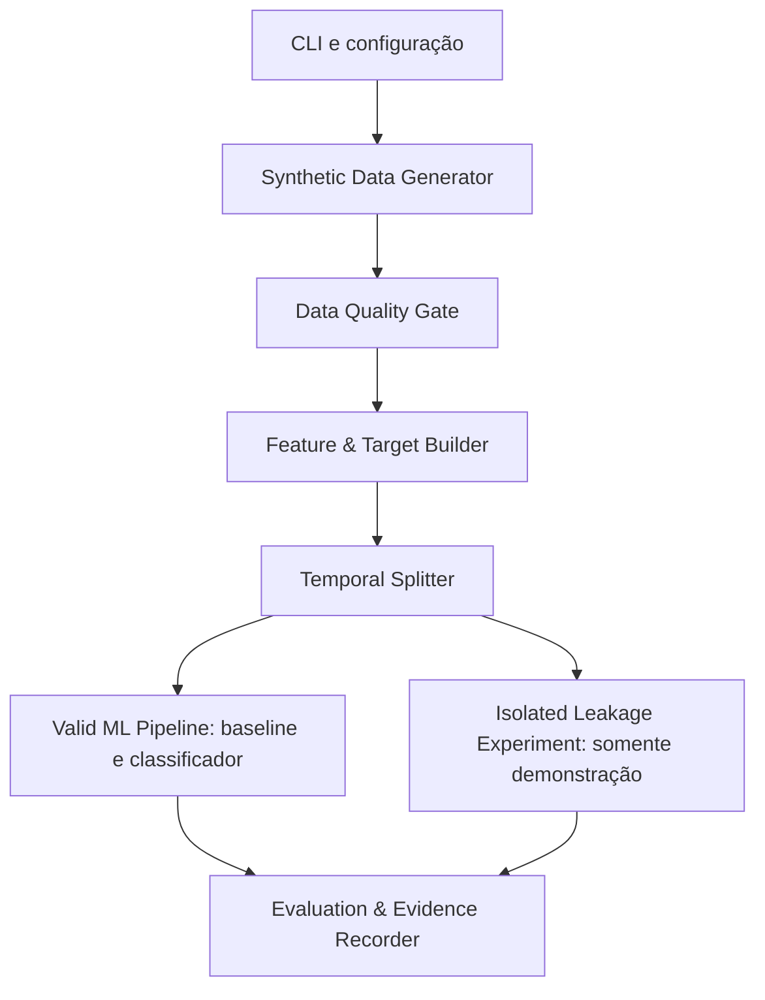

# Financial Market ML — Architecture Document

**Versão:** 0.1  
**Status:** Aprovada pelo responsável do projeto (decisão na conversa; publicação mediante PR)  
**Metodologia:** BMad Method  
**Referências:** [Product Brief v0.1](product-brief.md) · [PRD v0.1](prd.md)  
**Escopo:** Lab 01 — Financial Asset Price Direction Classification  
**Estratégia:** Local First → AWS Later

---

## 1. Objetivo

Definir a arquitetura técnica do primeiro laboratório Financial Market ML, com foco em modularidade, contratos explícitos, prevenção de data leakage, testes e reprodutibilidade.

A solução deverá permitir que o estudante implemente independentemente os componentes e demonstre, com evidências, a validade ou as limitações do experimento. A arquitetura não deverá antecipar infraestrutura incompatível com o tamanho e a maturidade do MVP.

## 2. Architectural Drivers

| Driver | Prioridade | Requisito |
|---|---|---|
| Integridade temporal | Crítica | RF-03, RF-04, RF-06 |
| Qualidade dos dados | Alta | RF-01, RF-02 |
| Reprodutibilidade | Alta | RF-08, RNF-01 |
| Testabilidade | Alta | RNF-03 |
| Simplicidade | Alta | RNF-05 |
| Portabilidade | Média | RNF-02 |
| Evolução para AWS | Baixa no MVP | Roadmap futuro |

A integridade temporal tem precedência sobre otimizações de desempenho e conveniência operacional.

## 3. Architectural Style

Adotar um **monólito modular batch**, com responsabilidades separadas e interfaces testáveis.

- Execução local por linha de comando.
- Componentes sem dependência de infraestrutura cloud.
- Dados e configurações explícitos.
- Resultados persistidos em artefatos locais.
- Erros propagados com contexto.
- Experimentos válidos e inválidos identificados separadamente.

Não utilizar inicialmente microsserviços, mensageria, orquestração distribuída ou banco de dados.

### Fluxo lógico



O caminho inválido é isolado e explicitamente marcado como metodologicamente inválido. Testes de integridade e evidências atravessam as etapas.

## 4. Logical Components

### 4.1 Synthetic Data Generator

**Responsabilidade:** produzir série OHLCV sintética e determinística.

**Entradas:** identificação do ativo, seed, quantidade de pregões, data inicial e parâmetros de geração.

**Saída:** registros OHLCV.

**Invariantes:** `ticker + date` único; datas ordenáveis; preços válidos; coerência entre open, high, low e close; volume não negativo; reprodutibilidade com parâmetros equivalentes.

A primeira versão utilizará uma sequência configurada de dias úteis como calendário sintético. A ausência de feriados reais será documentada: o calendário não representa uma bolsa oficial.

A geração deve permitir variabilidade controlada, sem pressupor que a série represente fielmente um ativo real.

### 4.2 Data Quality Gate

**Responsabilidade:** validar dados antes da modelagem.

**Entrada:** observações OHLCV.

**Saída:** conjunto validado ou relatório de rejeição.

**Regras:** schema, unicidade de chaves, nulos obrigatórios, restrições OHLC, valores finitos, datas e volume válidos.

**Política inicial:** fail-closed; registros inválidos não podem seguir silenciosamente para treinamento.

### 4.3 Feature & Target Builder

**Responsabilidade:** produzir indicadores históricos e rótulos supervisionados com papéis distintos.

**Entrada:** OHLCV validado e especificação de features.

**Saída:** features históricas e target alinhado por data.

**Features candidatas:** `return_1d`, `sma_5`, `sma_20`, `volatility_20`, `volume`.

**Target:** `target_up = 1` quando o fechamento ajustado de `t+1` superar o de `t`; caso contrário, zero.

Cada feature utilizará apenas registros disponíveis no instante de previsão. Histórico insuficiente exige tratamento explícito; não serão usadas imputações retrospectivas baseadas em valores futuros.

### 4.4 Temporal Splitter

**Responsabilidade:** dividir observações elegíveis em treino, validação e teste.

**Entradas:** dataset preparado e configuração de fronteiras.

**Saídas:** conjuntos disjuntos e metadados temporais.

**Política inicial:** proporções aproximadamente 70%/15%/15%; ordenação cronológica; sem embaralhamento; horizonte de um pregão; verificação explícita de disponibilidade dos rótulos nas fronteiras.

As proporções são calculadas sobre observações elegíveis após exclusões necessárias.

**Invariante de fronteira:** rótulos usados no ajuste do modelo precisam estar disponíveis antes do primeiro instante de previsão do conjunto seguinte. Registrar quantidade efetiva por conjunto e exclusões nas fronteiras.

### 4.5 Model Training

**Responsabilidade:** treinar classificador e baseline.

**Modelo candidato:** regressão logística.

**Baseline:** sempre prever a classe majoritária determinada exclusivamente pelo treinamento.

Normalização, imputação estatística e quaisquer transformações que aprendam parâmetros devem ser ajustadas somente sobre o treino. A validação pode subsidiar escolha de configurações. O teste permanece isolado até a avaliação final.

### 4.6 Leakage Experiment

**Responsabilidade:** reproduzir uma avaliação deliberadamente inválida, apenas para demonstrar o problema.

**Diferença controlada:** incluir `future_return_1d` como feature, informação indisponível em `t`.

Usar o mesmo universo de registros, períodos, rótulos e demais configurações do experimento válido sempre que possível. O pipeline válido deve bloquear features futuras proibidas. Resultados do caminho inválido são identificados como inválidos, independentemente do desempenho.

### 4.7 Evaluation

**Responsabilidade:** avaliar predições e compará-las à baseline.

**Saídas:** accuracy, precision, recall, F1-score, confusion matrix e distribuição das classes.

Preservar alinhamento por observação/data/target; diagnosticar classe ausente e predição constante. Métricas não constituem prova de rentabilidade ou vantagem financeira.

### 4.8 Evidence Recorder

**Responsabilidade:** manter evidências técnicas de execução.

**Conteúdo mínimo:** `run_id`, configuração, seed, ambiente/versões, hash ou identificação do dataset, fronteiras, quantidade de registros, features, tipo de experimento, métricas, resultados efetivos dos testes e limitações.

Testes não executados permanecem identificados como ausentes/não executados, nunca aprovados.

## 5. Physical Data Contracts

### 5.1 Market Dataset

**Formato proposto:** CSV UTF-8.  
**Chave:** `ticker + date`.

| Campo | Contrato |
|---|---|
| `ticker` | string não vazia |
| `date` | data ISO 8601 |
| `open`, `high`, `low`, `close` | numéricos finitos e positivos |
| `volume` | numérico finito não negativo |

Precisão, representação decimal e arredondamento serão fixados na especificação do gerador, validando a coerência depois de serializar e reler. O OHLC sintético utiliza uma série ajustada coerente, sem tratar eventos societários reais.

### 5.2 Prepared Dataset

Metadados identificadores, data, features históricas, informação de disponibilidade e target conhecido quando aplicável. A existência de uma coluna não autoriza seu uso como feature. Separar logicamente features permitidas, rótulos e metadados, mesmo que o armazenamento físico seja único.

### 5.3 Experiment Metadata

**Formato:** JSON UTF-8, com uma identificação para associar cada execução aos dados, configurações, features, modelo e resultados.

## 6. Data Flow

1. Carregar configuração.
2. Gerar dados sintéticos.
3. Validar contrato OHLCV.
4. Construir features e rótulos.
5. Identificar observações elegíveis.
6. Dividir cronologicamente.
7. Verificar disponibilidade dos rótulos e isolamento.
8. Treinar baseline e classificador válido.
9. Avaliar ambos.
10. Executar experimento adversarial separado.
11. Registrar métricas, diagnósticos e evidências.

Falhas de contrato crítico bloqueiam o fluxo válido. Falhas esperadas do caminho adversarial são registradas como evidências com identificação explícita.

## 7. Project Structure

Estrutura **sugerida, não criada**:

```text
financial-market-ml/
├── README.md
├── README.en.md
├── docs/
│   ├── product-brief.md
│   ├── prd.md
│   ├── architecture.md
│   └── decisions/
├── src/
│   └── financial_market_ml/
│       ├── data/
│       ├── quality/
│       ├── features/
│       ├── validation/
│       ├── modeling/
│       ├── experiments/
│       └── evidence/
├── tests/
│   ├── unit/
│   ├── integration/
│   └── adversarial/
├── configs/
├── artifacts/
├── pyproject.toml
└── Dockerfile
```

Diretórios representam responsabilidades; não criar arquivos vazios nem classes por módulo apenas para corresponder à estrutura. Artefatos gerados devem ser excluídos do Git por padrão, exceto pequenas evidências sintéticas selecionadas para divulgação.

## 8. Architecture Decision Records

### ADR-001 — Modular Monolith

**Status:** Aprovada na Architecture v0.1.  
**Decisão:** um processo batch, dividido por responsabilidades.  
**Alternativas:** notebook único; arquitetura distribuída.  
**Justificativa:** equilíbrio entre simplicidade, clareza e testabilidade.  
**Trade-off:** planejamento de interfaces em troca de menor complexidade operacional.

### ADR-002 — Local File Storage

**Status:** Aprovada na Architecture v0.1.  
**Decisão:** CSV para dados; JSON para evidências e metadados.  
**Alternativas:** Parquet, SQLite e banco gerenciado.  
**Justificativa:** inspeção e portabilidade no pequeno MVP.  
**Trade-off:** limitações para grandes volumes, concorrência e consultas complexas.

### ADR-003 — Temporal Integrity

**Status:** Aprovada na Architecture v0.1.  
**Decisão:** divisão cronológica com verificação do horizonte de rótulos e fronteiras.  
**Alternativas:** divisão aleatória e validação cruzada convencional.  
**Justificativa:** avaliar previsões sobre períodos posteriores ao treinamento.  
**Trade-off:** menor flexibilidade amostral, sensibilidade a regimes temporais.

### ADR-004 — Controlled ML Pipeline

**Status:** Aprovada na Architecture v0.1.  
**Decisão:** features separadas dos rótulos e transformações ajustáveis encapsuladas no treinamento.  
**Alternativa:** transformar dados globalmente antes da divisão.  
**Justificativa:** evitar contaminação estatística do conjunto de avaliação.  
**Trade-off:** maior disciplina de encadeamento.

### ADR-005 — Isolated Adversarial Experiments

**Status:** Aprovada na Architecture v0.1.  
**Decisão:** experimentos inválidos isolados e explicitamente rotulados.  
**Alternativa:** alternar arbitrariamente features na execução válida.  
**Justificativa:** impedir divulgação de avaliação contaminada como válida.  
**Trade-off:** pequena duplicação intencional de configuração.

> Os ADR-001 a ADR-005 deste repositório são decisões locais do Financial Market ML. Não substituem nem renumeram a decisão de governança **Life Learning LL-ADR-002**.

## 9. Test Architecture

**Unitários:** regras OHLCV, reprodutibilidade do gerador, features e target, bloqueio de features proibidas.

**Integração:** geração → qualidade → features; features → split → treino; baseline → classificação; persistência de evidências.

**Adversariais:** todos os cenários V1-01 a V1-12 definidos no PRD, validando falhas e invariantes em vez de valores arbitrários de métricas.

**Reprodutibilidade:** comparar parâmetros, hashes, fronteiras, resultados e tolerâncias entre execuções equivalentes.

## 10. Error Handling

Categorias conceituais (não classes implementadas):

- `DataContractError`: schema ou integridade.
- `TemporalIntegrityError`: disponibilidade temporal.
- `ExperimentConfigurationError`: configuração inválida.
- `TrainingError`: falha de treinamento.
- `EvidenceWriteError`: persistência de evidência.

Erros devem indicar componente, contexto e regra violada sem dados sensíveis.

## 11. Observability

Logs estruturados ou consistentemente formatados: execução, componente, evento, resultado e causa.

Indicadores candidatos: registros gerados/aceitos/rejeitados, tamanho de cada split, duração de etapas, falhas por tipo e métricas por experimento. Sem serviço externo de telemetria no MVP.

## 12. Execution and Reproducibility

O MVP terá ponto de entrada local com configuração explícita, dependências reproduzíveis e execução via Docker.

Operações planejadas: gerar dados, validar, executar experimento, executar testes e consultar evidências. Comandos concretos serão definidos no Implementation Plan e **não existem ainda**.

## 13. Security and Governance

- Sem credenciais de corretoras.
- Sem dados privados ou proprietários.
- Sem secrets e arquivos de ambiente publicados.
- Branch principal protegida e integração por PR.
- Resultados e testes declarados somente se efetivamente realizados.
- Sem recomendações de investimento.

## 14. AWS Evolution

| Responsabilidade local | Candidato AWS |
|---|---|
| Arquivos de dados | Amazon S3 |
| Processamento | SageMaker Processing |
| Treinamento | SageMaker AI |
| Logs e métricas operacionais | Amazon CloudWatch |
| Transformações distribuídas, se justificadas | AWS Glue |

A adoção cloud requer análise de custos, permissões, segurança, operação e necessidade real; não autoriza provisionamento.

## 15. Implementation Independence

**I0:** estudante decide e implementa internamente os componentes, sem código de solução pronto.  
**A1:** assistência posterior com intervenções declaradas.  
**V1:** revisão adversarial de qualidade, invariantes, evidências e arquitetura.  
**R1:** retenção e transferência para problemas novos.

Conclusão de tarefas não equivale a aprovação automática de competência.

## 16. Architecture Exit Criteria

1. Componentes e responsabilidades definidos.
2. Contratos e invariantes verificáveis.
3. Integridade temporal explícita.
4. Experimento adversarial isolado.
5. Testes cobrindo os requisitos do PRD.
6. Armazenamento e evidências definidos.
7. Decisões e trade-offs documentados.
8. MVP sem dependência obrigatória de AWS.

A aprovação da Architecture v0.1 habilita o **planejamento** da implementação, não autoriza código, infraestrutura ou commits adicionais.

---

> **Correctness before complexity. Evidence before optimization.**
